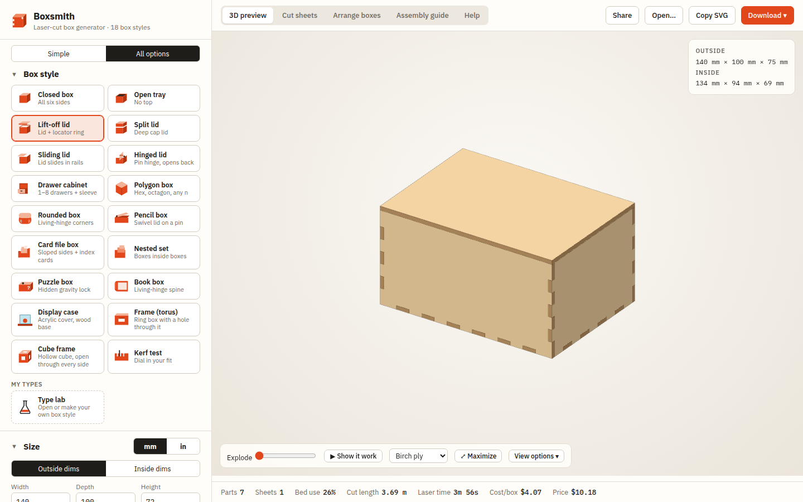

# Boxsmith

[](LICENSE)

**Design finger-jointed boxes for a laser cutter, in the browser.**

**Live app:** [https://markplaga.github.io/Boxsmith/](https://markplaga.github.io/Boxsmith/)



Open the live app, or open `index.html`. There is no build step and no server. Nothing you design is uploaded.

## Features

- 18 box styles, from a closed box and an open tray to living hinges, drawers, a puzzle box and a cube frame
- Finger joints with kerf compensation, inside or outside dimensions, millimetres or inches
- Corner construction: front & back, pinwheel, or diagonal pinwheel
- Fit presets, captive-nut T-slot screw joints (M2.5/M3/M4), CNC dogbones
- Egg-crate dividers, hand holds, a finger notch
- Multi-line text (raster fill, vector outline or cut-through) with alignment, converted to outlines
- PNG / JPG / SVG artwork on any panel, cut-out patterns, corner accents, rounded or chamfered lid corners
- 3D preview (three.js) with explode, “show it work” animations, screws and nuts, tap-to-select
- Paint finish: preview a watercolor wash or acrylic paint color on any box
- Arrange intact box designs side by side, inside other boxes or in a Frame opening, with snap-to-face, drag to move, step-by-size, duplicate in place, per-box materials, part and acrylic coloring, overlap warnings, and save and open for layout files
- Two-screen editing: pair a second screen (such as an iPad) with a code and edit placement, color, every box setting and the layout from it. Scripts and AI helpers can use the same link to send whole animations, play them, and get back pictures, contact sheets and WebM/GIF recordings. Same-computer windows connect directly; other devices use the small relay in `relay/` (a Hugging Face Docker Space)
- Picture mosaic: upload a picture and Boxsmith picks the paint colours and builds a layout of boxes (optional relief and frame)
- Sheet nesting with hole filling and grain lock, batch quantity, kit-mode hold tabs
- SVG and DXF export (simple or LightBurn-ordered layers), printable assembly card
- **Share** copies a link to this design, and opening it rebuilds the same box. A plain link, with no design code, still opens the standard box (or the one this browser already saved)
- Cost estimate, saved materials and recipes (stored in the browser)
- Built-in Help tab; standalone guide in `help.html`

## JavaScript API

Everything the page does can be scripted. In the browser console on the Boxsmith page:

```js
const tray = Boxsmith.boxes.create('open', { W: 140, D: 90, H: 42 });
Boxsmith.browser.showBox(tray);

const files = Boxsmith.design.compute(tray).files; // SVG, DXF and an assembly card
```

The same API runs in Node.js. `npm install jsdom @napi-rs/canvas`, then:

```js
const { load } = require('./boxsmith-node.js');

(async () => {
  const Boxsmith = await load();
  const design = Boxsmith.design.compute({ type: 'closed', W: 120, D: 80, H: 50, text: 'Spices' });
  console.log(design.outside, design.cost);
  Boxsmith.close();
})();
```

Pictures (`render`) also need `playwright-core` and Chrome. `npm test` checks that every control on the page is reachable from the API. [API reference and examples](API.md)

## Share a design

**Share** copies a URL whose `d` parameter is this box: style, size, material, text, joints and the rest of the settings. Opening it rebuilds that box, including on another computer. Very large artwork images are left out of the link (it would be too long to share) and the button says so.

A link with no `d` parameter works as before: the box this browser last saved, or the standard 120 × 90 × 70 mm closed box when nothing is saved.

## Analytics

Boxsmith does not load an analytics script until you set one value in [`site.config.js`](site.config.js). Until then `analytics` is `''`, nothing is requested, and no cookie is set.

The hook is cookie-free and speaks GoatCounter or Plausible. Create an account, then set `analytics` to one of:

| Value | What it does |
| --- | --- |
| `'goatcounter:yourcode'` | Page views go to `https://yourcode.goatcounter.com`. `yourcode` is the name you chose when you signed up. |
| `'goatcounter:https://stats.example.com/count'` | A GoatCounter you host yourself. |
| `'plausible:markplaga.github.io'` | Page views go to [Plausible](https://plausible.io) for that domain. Add the domain there first. |
| `'plausible:markplaga.github.io@https://plausible.example.com'` | Plausible on your own server. |

Reload the site. The script sends a page view, plus events when someone copies a design link or downloads a file (`share`, and `download` with the format). In Plausible, add those names as custom event goals if you want them on the dashboard. In GoatCounter they show up as paths `share` and `download/svg` (also `dxf`, `json`, `sheet`, `card`, `svg-copy`).

Set `analytics` back to `''` to turn it off.

## Follow and tip links

The sidebar credits Mark Plaga and links to [the repository](https://github.com/markplaga/Boxsmith). Instagram, YouTube and Ko-fi are slots in `site.config.js` under `links`. Each one stays hidden until it is a full `https://` URL:

```js
links: {
  instagram: 'https://instagram.com/yourname',
  youtube: 'https://youtube.com/@yourname',
  kofi: 'https://ko-fi.com/yourname'
}
```

## Box styles

Closed box · open tray · lift-off lid · split lid · sliding lid · hinged lid (pin) · drawer cabinet (1–8 drawers) · polygon box · rounded box (living-hinge corners) · pencil box (swivel lid) · card file box · nested set · puzzle box (gravity-pin lock) · book box (living-hinge spine) · display case (acrylic cover, wood base) · frame (torus) · cube frame (open through every side) · kerf test

## New box styles

A box type file describes a new style of box in JSON, with formulas but no code, and Boxsmith builds it, checks that every joint meets, and treats it like a built-in style. [Format reference](BOX-TYPES.md) · [How an AI builds and checks one](AI-TYPE-BUILDER.md) · [JSON Schema](boxsmith-type.schema.json) · [Examples](types/) · [Shared types](https://github.com/markplaga/markplaga-boxsmith-type)

## Files

- `index.html` — page and styles
- `app.js` — box geometry, layout, export, UI
- `share.js` — encode and read a design link
- `site.config.js` — analytics and follow/tip links (empty until you fill them in)
- `site.js` — maker-credit links and the analytics hook
- `og.png` — the 1200×630 image used when the link is shared
- `boxsmith-api.js` — box catalog and portable assembly files
- `box-types.js` — the box type format: the formula language and the file checker
- `boxsmith-engine.js` — adds cut sheets, costs, layout measuring and snapping, mosaic, library and preview control to the API
- `boxsmith-node.js` — runs the whole page headlessly so Node.js gets the complete API (pictures also need `playwright-core` and Chrome)
- `test/` — API tests (`npm test`)
- `box-layout.js` — placement and browser storage for whole boxes
- `mosaic-core.js` — picture-to-mosaic algorithm (colour picking, dithering, layout); also usable from Node
- `mosaic.js` — the Picture mosaic controls
- `tools.js` — tracing, text outlines, artwork, dogbones, patterns, nesting, accents
- `help.html` — standalone help guide
- `three.min.js` — three.js r128 (MIT)

## License

[MIT](LICENSE) © 2026 Mark Plaga
